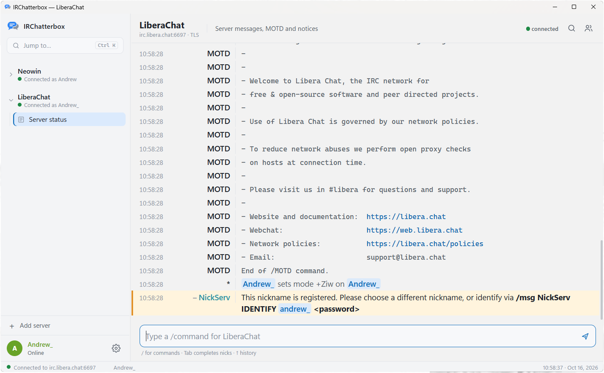
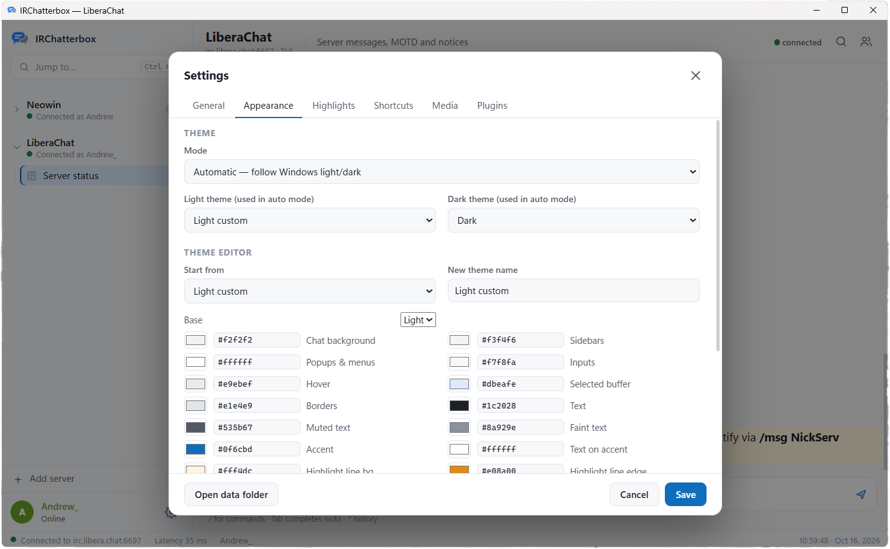

  <picture>
    <source media="(prefers-color-scheme: dark)" srcset="assets/logo-dark.png">
    
  </picture>

A modern IRC client for Windows. The backend is Go and the UI is built with Wails (WebView2).

## Screenshots

  

  

## Run it
Double-click `IRChatterbox.exe`. No install is needed. It uses WebView2, which comes with Windows 10 and 11.
Settings, logs, themes and plugins live in `%APPDATA%\IRChatterbox` (Settings → Open data folder).

## Features
- **Saved servers and auto-login.** Each server can use SASL PLAIN (recommended) or NickServ IDENTIFY, connect on startup, auto-join channels (with keys) and run commands on connect. It reconnects automatically with backoff.
- **Sidebar.** Servers collapse to show the channels and queries under them. Unread counts appear in grey. Pings and PMs appear in red, and a collapsed server shows a combined badge.
- **Highlights.** Your nick and any highlight words trigger three things: a coloured line, a red badge and a Windows toast. Clicking the toast opens that channel.
- **Inline media.** PNG, JPG, GIF, WEBP and AVIF links, plus imgur. YouTube links show a thumbnail and play in the chat when clicked. You can turn either off in Settings → Media.
- **Nick colours.** Colours are automatic per nick. Override one with `/color nick #ff8800`, `/color nick orange` or `/color nick reset`, or right-click a nick.
- **Commands.** Every IRC command works, and `/help` lists the built-in ones. Anything the client doesn't recognise is sent to the server as-is (`/knock #chan` → `KNOCK #chan`).
- **Themes.** Automatic mode follows Windows light/dark (Settings → Personalisation → Colours → app mode) and switches live. Built-in themes are Dark, Light, Midnight and Classic. Settings → Appearance has a theme editor, and you pick which light and dark theme auto mode uses.
- **Logs and history.** Logs are JSON lines, and the last 200 lines reload when you open a channel.
- **Start with Windows.** Optionally start minimised (Settings → General).
- **Quit confirmation.** Closing the window asks before disconnecting you. Tick "Don't ask me again" or turn it off in Settings → General.
- **Topics.** Double-click a channel topic to change it.
- **Marker line.** A red line divides messages you've read from ones that arrived while you were in another channel or another app. You can turn it off in Settings → General.
- **Jump to latest.** When you scroll up, a round arrow takes you back to the newest messages and counts new lines below. Ctrl+End does the same.
- **Text shortcuts.** Type `$whatever` and it becomes `¯\_(ツ)_/¯`. Shortcuts expand when you press space or send, and typing `$` lists them. Edit them in Settings → Shortcuts or with `/shortcut add $name text`. The replacement can also be a command, such as `/me waves`.
- **Resizable nick column.** Drag the line between nicks and messages, or double-click it to fit the longest nick.
- **Keyboard.** Ctrl+K jumps to a channel. Ctrl+F filters the buffer. Alt+↑/↓ and Ctrl+Tab switch buffers, and Alt+A goes to the next unread. Tab completes nicks, ↑/↓ recall input history, and Ctrl+B/I/U add bold, italic and underline.

## Plugins
**Temperature converter (built in).** "Today it feels like 18c" → `[Bot] 18 C = 64.4 F`. It also handles °C, F, "fahrenheit", decimals and negatives. It reacts to your messages and other people's (each can be switched off), can be limited to certain channels, and never replies to lines that start with the bot prefix, so two bots won't loop.

**Now playing (`!music`, `/np`).** When anyone types `!music`, the bot replies with your current song: `[Bot] Now playing: Artist - Title`. `/np` sends `* you is listening to Artist - Title`. The song is read from Windows media controls, from MusicBee's window title, or from the text file written by MusicBee's [Now Playing to External Files](https://getmusicbee.com/addons/plugins/47/now-playing-to-external-files/) plugin. Settings → Plugins → **Test now** shows which of these works on your PC.

**URL commands (`!solar`).** Settings → Plugins. Set a trigger and a URL. By default only you can trigger them; untick "Only I can trigger it" to let others use one. Plain text or HTML replies are posted as up to N lines. JSON can be shaped with a Go template:

    Solar: {{.power}} W · today {{round .today_kwh 1}} kWh · {{kw .power}} kW

`{args}` in the URL is replaced by whatever follows the trigger (`!weather london`). Use the **Test** button to preview the output.

**JavaScript plugins.** Put `.js` files in `%APPDATA%\IRChatterbox\plugins`, then type `/reload`. `_example.js` documents the API: `on("message", fn)`, `reply()`, `say()`, `httpGet()`, `me()`, `log()`, `prefix`.

## Download
Get the latest `IRChatterbox.exe` from the [Releases](../../releases) page. Publishing a GitHub release builds the exe automatically and attaches it to that release.

## Build from source
The project is in `source/`. Requires Go 1.26+, Node 18+ and `go install github.com/wailsapp/wails/v2/cmd/wails@latest`.

    wails build                 # on Windows
    wails build -platform windows/amd64   # cross-compile from Linux/macOS
    wails dev                   # live-reload development

`source/frontend/src/mock.js` provides a fake backend, so the UI also runs in a normal browser (`cd source/frontend && npx vite`).

## Layout
Paths are relative to `source/`.

| File | What |
|---|---|
| `../.github/workflows/release.yml` | Builds the Windows exe when a release is published |
| `irc.go` | Connection, CAP/SASL, numerics, channel and user state |
| `commands.go` | `/command` handling |
| `plugins.go` | Temperature converter, URL commands, JS plugin runtime |
| `app.go` | Methods the UI calls, notifications, logging |
| `config.go` | `config.json`, themes |
| `frontend/src/main.js` | UI: sidebar, chat, user list, input |
| `frontend/src/modals.js` | Server editor, settings, theme editor |
| `frontend/src/format.js` | mIRC colours and formatting, links, media, nick colours |
