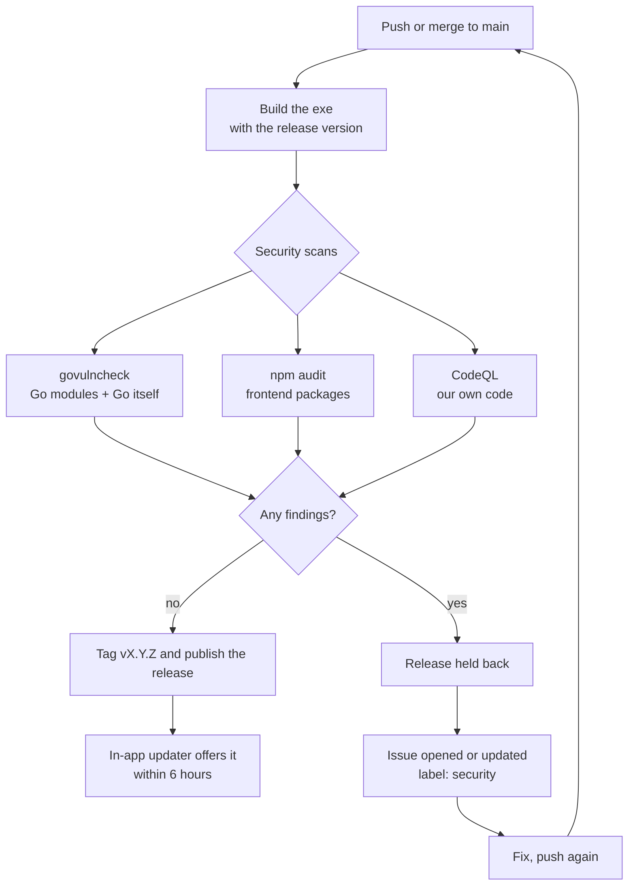

# Security flow: scan before release

Every change to `main` is scanned before it can be released. If a scan finds something, the release is held back and an issue is opened. Once a later scan is clean, the issue closes itself and the next push releases normally.



## The pieces

| File | Job |
|---|---|
| `.github/workflows/release.yml` (**Build**) | Builds the exe, calls the security scans, publishes the release only if both pass |
| `.github/workflows/security.yml` (**Security**) | The scans. Called by Build before a release; also runs daily and on pull requests |
| `.github/scripts/security-report.sh` | Turns scan results into GitHub issues and decides pass or fail |
| `.github/dependabot.yml` | Weekly pull requests for dependency updates (Go, npm, GitHub Actions) |
| `.github/SECURITY.md` | How people report a vulnerability privately |
| `source/frontend/index.html` | The app's Content Security Policy: a last line of defence if HTML ever slips into the chat |

## The scanners

| Scanner | Finds | Fix |
|---|---|---|
| **govulncheck** | Known CVEs in Go modules and the Go standard library, **only where our code actually calls the vulnerable function**, so there's very little noise. Scans as Windows, the platform we ship. | Module: `go get <module>@<fixed> && go mod tidy`. Go itself: raise the `go` line in `source/go.mod` (e.g. `go 1.26.9`). |
| **npm audit** | Known CVEs in the frontend's npm packages, including build tools like Vite | `cd source/frontend && npm audit fix`. A major version may need `--force` or a manual update. Dependabot often has a PR open already. |
| **CodeQL** | Bugs in our code: XSS, injection, path traversal, unsafe integer conversions and so on (the `security-extended` query set) | Open the alert link for the exact line and an explanation. Fix it, or dismiss it on GitHub as a false positive with a reason. |

## When it runs

| Trigger | Scans | Issues | Effect of a finding |
|---|---|---|---|
| Push or merge to `main` | Yes, called from Build | Opened or updated | **No release.** The run fails. |
| Daily at 7:23 Toronto | Yes | Opened, updated or closed | Run fails. Catches CVEs published after the last release. |
| Pull request | Yes | None | The PR check fails, so you see it before merging |
| Push to another branch | No | None | n/a |

The daily run matters because new CVEs are published against code that hasn't changed. Without it, you would only hear about a vulnerability in an existing release the next time you pushed.

## How the issues behave

There's one issue per scanner, labelled `security`:

- **Opened** the first time it finds something, with the findings, how to fix them, and a link to the run.
- **Updated** on every later scan. The body always shows the latest findings. A comment is added only when the findings actually change, so a daily re-scan of the same problem doesn't spam you.
- **Closed** automatically, with a comment, as soon as a scan is clean.

The issue is matched by a hidden marker in its body (`<!-- security-scan:go -->`), not by its title, so renaming an issue doesn't break anything.

If a scanner itself crashes (as opposed to finding something), no issue is opened, but the run fails so it doesn't go unnoticed.

## Releasing

- Each push to `main` that passes becomes the next patch (`v0.3.1`, `v0.3.2`, …).
- To start a new minor or major version, change `source/VERSION` to `0.4.0` and push.
- Pushes that only touch docs (`*.md`, `docs/`) or screenshots don't build or release.
- A release built from a Dependabot security PR goes out as soon as it's merged, so security fixes reach users automatically.

## Day to day

**A security issue appears.** Read it, fix it, push. The release that was held back goes out with the fix, and the issue closes itself.

**A Dependabot PR fails its checks.** It was usually opened before a fix landed on `main`. Comment `@dependabot rebase` on the PR and it reruns against current `main`.

**A false positive in CodeQL.** Dismiss the alert on GitHub (Security → Code scanning → the alert → Dismiss, with a reason). The next scan sees no open alerts and closes the issue.

**You need to release despite a finding.** You shouldn't normally need to. If you must (say, the finding is in a build tool that never ships in the exe), fix or dismiss it so the scan is clean, rather than bypassing the gate.

**Run the scans locally before pushing:**

```powershell
cd source
$env:GOOS="windows"; go run golang.org/x/vuln/cmd/govulncheck@latest ./...
cd frontend; npm audit
```

## One-time GitHub settings

Under **Settings → Code security**:

- **Dependabot alerts** and **Dependabot security updates**: on. Security fixes get a PR straight away instead of waiting for the weekly run.
- **Private vulnerability reporting**: on. The link in `SECURITY.md` depends on it.
- **Code scanning**: works automatically on a public repo. A private repo needs GitHub Advanced Security, and without it the CodeQL issue step is skipped with a warning.

Also turn on two-factor authentication for your GitHub account. The auto-updater trusts whatever is in your latest release, so your account is the most valuable thing to protect.

## Reusing this in another project

The flow isn't tied to IRChatterbox. To copy it:

1. Copy `security.yml`, `scripts/security-report.sh` and `dependabot.yml` into the other repo's `.github/`.
2. Change the scanners to fit the stack:
   - Go: keep govulncheck (change `GOOS` and the `working-directory`).
   - npm: keep npm audit (change the directory).
   - PHP: swap in `composer audit`.
   - Python: swap in `pip-audit`.
   - Set CodeQL's `language` matrix to the project's languages.

   Each scanner job only needs to write `<name>.txt` (the findings) and `<name>.status` (`clean`, `found` or `error`) and upload them as an artifact; then add a `report` line for it in the script.
3. In the release workflow, add a `security` job that calls `./.github/workflows/security.yml`, and make the release job `needs:` it.
